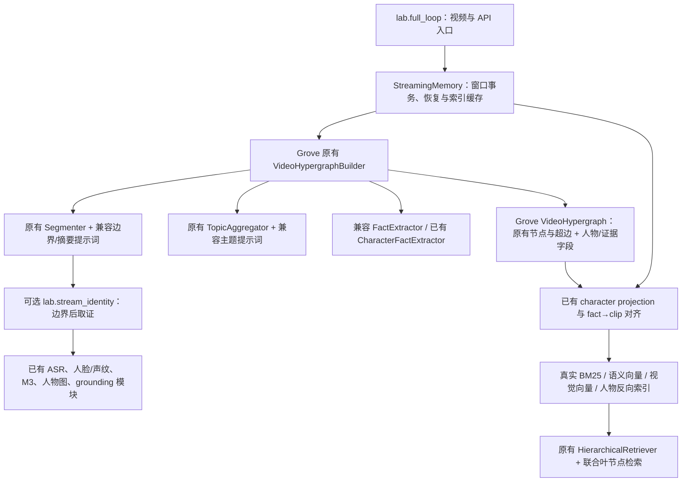
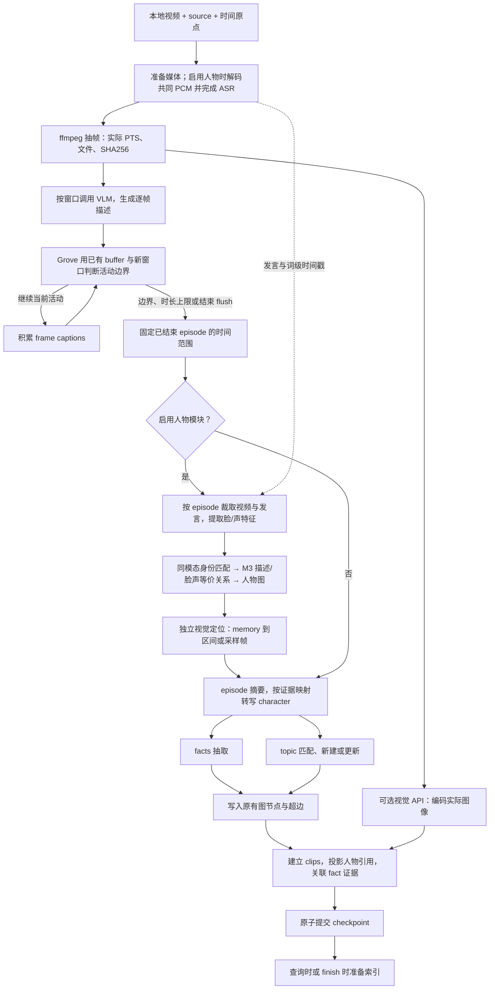
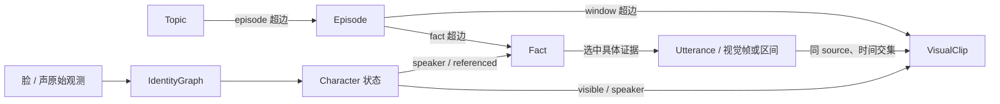
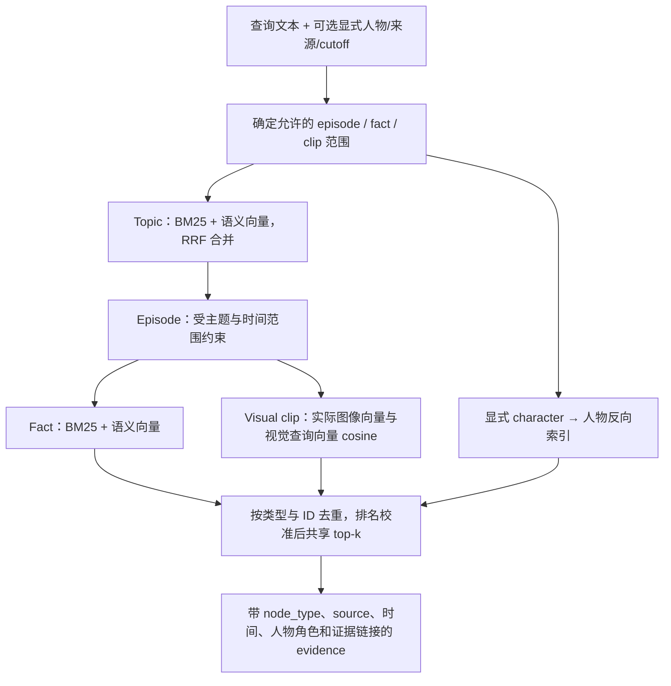

# 当前架构与数据流程

实现基准：`ca7222e`。本项目把人物身份和视觉证据接入 Grove 的记忆写入与检索，保留它的 **Topic → Episode → Fact** 组织方式，并让 visual clip 成为可直接返回的检索结果。人物图负责跨 episode 的身份连续性。

先了解前后差异可读 [改动说明](CHANGES.md)；安装、配置和运行命令见 [完整主循环手册](FULL_LOOP.md)。本页描述已经实现的行为，实时摄像头服务、并行取证和多源调度属于后续工作。

## 1. 代码如何组成一个系统

`lab/` 保留可单独测试的模型适配、身份关联和评估代码；`vendor/Grove/` 是固定上游代码加本项目补丁。`StreamingMemory` 负责把现有构建器串成可恢复的标准 QA 主循环，没有替换 Grove 的图数据模型。完整流程与单模块实验共用人物、证据和检索实现。

`vendor/Grove/` 不直接进入主仓库 Git；可交付内容是固定源码 bundle、补丁和校验和。新机器运行 `scripts/setup_grove.py` 后得到同一份代码。不能只拉取主仓库后继续使用旧 vendor，详见 [升级步骤](FULL_LOOP.md#已有部署如何升级)。

## 2. 写入流程：视频如何变成记忆

下面的箭头表示数据依赖。当前驱动顺序处理本地视频；启用人物时先准备整段 ASR，再进入 caption 窗口循环。

关键执行顺序：

| 阶段 | 输入 → 输出 | 当前执行方式 |
|---|---|---|
| 准备语音 | 原视频 → 共同的 16kHz 单声道 PCM → 发言片段 | 仅启用人物时运行；整段先做，可复用匹配音频哈希的 ASR 结果 |
| 抽帧与描述 | 帧像素 → 帧 ID、实际时间、caption | 当前先采样视频，再按窗口顺序请求 VLM；模型不决定时间戳 |
| 动态分段 | 历史帧描述 + 新窗口帧描述 → 延续或关闭旧 episode | 沿用 Grove stream segmenter；包含硬边界、最大 buffer 和末尾 flush |
| 人物取证 | 已确定 episode + 历史人物图 → 当前人物证据快照 | 边界确定后才调用；先前人物图只来自已提交 episode |
| 摘要 | 当前帧描述 + 可选身份/记忆证据 → subject、summary 等 | 有人物时先取得证据，再生成摘要并转换标签 |
| facts 与 topic | 同一 episode → 原子事实、主题归属/更新 | 默认可以并发；facts 不必等待 topic 生成，入图时绑定最终 topic ID |
| clip 与投影 | 帧时间窗、图像向量、身份时间线、fact 引用 → clips、人物索引、证据边 | 成功后随本窗口一起提交；这部分按代码规则计算 |

**语音分段和 episode 分段是两种不同的边界。** 前者描述谁在什么时间说了一段话；后者根据视频活动组织记忆。两者不要求一一对应，ASR 的 speaker 标签也不是全局 character ID。

示例配置每 2 秒采样、每 10 秒发一次 caption 请求；episode 可以包含多个窗口，不能把“10 秒请求窗口”理解为固定 10 秒 episode。新主循环中每个 frame caption 对应一个 clip 时间窗，通常约为采样间隔，尾窗可能更短。clip 是源视频中的可定位范围和元数据，主循环不会为每个 clip 都另写一个 MP4。

## 3. Episode、Fact、Clip、Character 分别管什么

| 数据对象 | 保存的主要信息 | 作用及边界 |
|---|---|---|
| FrameCaption | 一次采样的描述、所属窗口、时间范围 | 动态分段和摘要的观测输入；时间范围不表示整段都被逐帧观察过 |
| Episode | 动态活动边界、摘要、原始 captions、相关人物证据 | 回答“这一段发生了什么”；不能把其中所有人都归给每条 fact |
| Fact | 一条具体陈述、所属 episode/topic、选中的发言/视觉证据、人物引用 | 回答“具体记住了什么”；人物归属只沿这条 fact 引用的证据确定 |
| VisualClip | source、起止时间、父 episode、caption、视觉向量关联、人物出现/说话引用 | 回答“去哪里回看”和“哪段图像与问题相关”；可独立于 fact 命中 |
| Topic | 多个 episode 的主题、摘要及组织超边 | 提供跨片段的主题组织和检索入口；不是逐条事实或身份的证据来源 |
| 身份源图 IdentityGraph | 不可变脸/声观测、候选/确认/撤销边、审计历史 | 决定观测属于哪个稳定人物；不同 episode 不重新从零编号 |
| Character 状态与反向索引 | character ID、观测归属、别名/可选姓名、人物到 clip/fact 的引用 | Grove 侧可查询的身份投影；不新增与 Fact/Episode/Topic 同级的语义主层 |
| Fact evidence / clip edges | 发言区间或视觉帧/区间，以及与 clips 的时间交集 | 指明每条 fact 的依据位于哪里；与“某人在该 clip 出现过”是不同关系 |

这些关系保存于现有图字段、超边和派生索引，不要求一个 person 只能属于一个 episode，也不要求一个 fact 只能引用一个 clip。

## 4. 人脸和声音到底怎样变成同一个人

1. **各自提特征。** 人脸使用 InsightFace buffalo_l，按 M3 策略做 HDBSCAN、质量筛选和代表脸选择；声音使用 ERes2NetV2，合格轮次从共同 PCM 切片提声纹。脸向量和声纹向量各自处在不同空间。
2. **先做同模态历史匹配。** 人脸对历史脸、声音对历史声音分别匹配，声音轮次先归到 voice 节点。这里的脸内聚类和声音阈值归并使用不同算法；不会直接计算脸向量与声纹向量的相似度。
3. **再做音画关联。** M3-Agent-Memorization 接收 episode 视频、代表脸和按 voice 节点汇总的转录，输出描述、结论及 `Equivalence: <face_N>, <voice_N>`。原始 M3 联合 prompt 保留。
4. **由身份图决定映射。** 候选关联只有按策略确认为边后才参与合并。`characters.accept_links=true` 表示按实验策略采纳模型结果，不是人工核实；默认 false 保留候选。已确认边的连通关系生成稳定的 `person:...` ID。
5. **写入时转换标签。** writer 使用已提供的 `<face_N>` / `<voice_N>` 和证据 ID，代码按同一版本的映射转成 `<person:...>`，同时保留原文和原始观测引用。

`person:...` 是内部身份，不自动代表真实姓名。姓名需要显式登记。小于 2 秒的发言保留文字和 unknown 引用，但不创建声纹身份。跨 episode 的发言只有在有词级时间戳时才按词保留当前范围文字；否则部分切片不复制整句全文。

M3 的身份等价关系不提供逐句嘴型同步/画内说话人判断。clip 的 `visible` 来自完整采样检测时间线，`speaker` 来自发言时间与声音身份；两者同时出现也不能自动解释为“画面中此人当时嘴型与声音同步”。细节见 [人物图说明](CHARACTER_GRAPH.md)。

## 5. 用一个例子说明 fact 的人物与 clip 归属

下面是说明机制的假设例子，不是实际模型测评结果。为便于阅读使用视频相对秒；文件里使用 `time_origin + 相对秒`，并携带 source。

- 动态分段得到 episode `[10, 24)`。
- 发言 `u1` 在 `[12.2, 15.2)`，文字是“我等会儿拿杯子”，所属 `<voice_0>`。
- M3 描述 `description:0` 是“`<face_0>` 拿起杯子”；独立视觉定位提供 18.6 秒的支持帧。
- 有证据的确认关联将 `<face_0>`、`<voice_0>` 映射到同一个人物 P1。

| writer 生成的 fact | 选择的证据 | 人物字段 | 代码生成的 clip 关联 |
|---|---|---|---|
| P1 说“我等会儿拿杯子” | `utterance_ids=[u1]` | `speaker=P1`；正文标签还可记 `referenced` | clip `[12,14)` 中的 `[12.2,14)`，以及 clip `[14,16)` 中的 `[14,15.2)` |
| P1 拿起杯子 | `memory_ids=[description:0]` | `referenced=P1`；当前不自动生成结构化 `actor` 标签 | 18.6 秒采样点落在 clip `[18,20)`，保留帧 ID/路径/哈希 |

第一条语音证据只能支持“说过这句话”，不能据此生成第二条已发生的动作。第二条需要独立视觉证据。如果视觉定位失败，系统保留 `unlocalized`，不把整个 episode 或所有出现过 P1 的 clips 当成事件证据。

代码验证 ID 是否来自输入、标签是否有被引用的证据、时间是否在范围内、身份版本是否一致。**引用是否在语义上真正支持陈述，仍取决于模型输出和人工准确率评估。** 相关契约见 [fact→clip 说明](FACT_CLIP_EVIDENCE.md)。

## 6. 检索如何同时返回 fact 和 visual clip

文字检索仍按 Grove 的 topic → episode → fact 层级组织。clip 在叶节点阶段与 fact 并行参与结果排序，不要求先命中某条 fact。配置里的 `fact_top_k` 在联合路径中用作 fact/clip 共享的结果预算，名字保留兼容。

显式传入的 character 可以通过人物反向索引召回语义 top-k 之外的相关记录，再与语义结果合并；来源和截止时间仍需满足。`character_roles` 限制人物通道，不代表把其他语义结果全部过滤掉。当前不会从自然语言“他”或未登记姓名中自动确定人物。

`use_visual_channel=false` 时不进行图像语义召回，但 fact 已有的具体 clip 引用仍保留。人物精确查询也可单独走 `character-lookup`。完整主循环 CLI 的 `--query` 返回检索证据，不额外调用答案模型生成自由文本回答。

## 7. 当前各阶段用什么模型

| 阶段 | 当前实现/选择 | 模型是否固定 |
|---|---|---|
| 帧描述 | 支持多图的 OpenAI-compatible VLM API | 配置填写模型和 revision，尚未选出经过实测的推荐模型 |
| 动态边界、摘要、topic、fact writer | 文本聊天 API；可与 VLM 共用部署 | 同样可配置；新增兼容 prompt 不声称等同作者原 prompt |
| ASR | Gemini / faster-whisper + pyannote / FunASR | 三个可比较的前端，每次选择其中一个 |
| 人脸 | InsightFace buffalo_l + M3 原始 HDBSCAN 与代表脸规则 | 已有本地取证实现，需准备权重与依赖 |
| 声纹与分组 | ERes2NetV2 + 声音节点平均相似度匹配 | 已有本地取证实现，转录的 speaker 标签不充当全局身份 |
| 脸声关联与联合描述 | ByteDance-Seed/M3-Agent-Memorization | 当前默认是本地 checkpoint 路径，不是新增的通用 API 服务 |
| 视觉事件定位 | 已有多图 grounding API | 与 M3 分开调用，输出帧/区间证据 |
| 文本检索向量 | `/v1/embeddings` | 构建和查询必须使用同一部署版本/空间 |
| 视觉检索向量 | Grove visual encoder server 的图像/文本编码接口 | backbone、维度、版本显式配置；与文本检索 embedding 是不同通道 |

因此“核心主循环通过 API 调模型”不表示人物取证也已全部 API 化。当前标准配置默认不启用 `characters`，但默认开启 `use_visual_channel`；开启人物需要另加已有语音/感知/M3/grounding 配置。

## 8. 保存、恢复与身份修订

一次 caption 窗口在独立构建器副本中处理，成功后原子替换 `checkpoint.json`。窗口涉及的摘要、fact、topic 或角色分配失败时，已提交图和待处理 buffer 不变；已产生的临时推理产物不会自动成为历史身份图。索引失败保留已提交图，重跑可重新建索引。

| 产物 | 用途 |
|---|---|
| `checkpoint.json` | 主循环权威恢复点：图、buffer、已提交窗口、输入/配置指纹、帧目录 |
| `hypergraph.json` / `builder_state.json` | Grove 格式导出，便于查看和组件工具读取 |
| `frames.json` / `caption-*.json` | 抽帧及模型描述缓存，避免恢复时重复请求 |
| `identity-speech.json` / `identity-*.json` | 可选 ASR 和身份快照；保存来源、配置、prior 与身份图 |
| `indices/` / `index_manifest.json` | 文本/视觉索引及内容校验；人物反向索引在图中保存 |
| `run_report.json` | 完成状态、数量与检索结果；不自动给出准确率 |

已有人物修订模块可以确认/撤销身份边，再从原始观测和原文重建 fact/episode/clip 引用及正文；主题中的失效人物 token 会标 unknown 并登记待重新摘要。视觉像素向量不需要因 ID 改名重新编码。

要区分两种更新：主循环会用当前已提交/新取到的身份状态刷新派生投影；人工 `identity-review → grove-project` 产生的是独立审核状态和新图。**当前没有把人工审核图自动导回运行中 `checkpoint.json` 的命令**，单改 `hypergraph.json` 不会更新恢复点。不要把离线审核导出当作已经完成在线 checkpoint 迁移。

## 9. 已验证到什么程度

基准实现通过 173 项测试；加入本地 SigLIP 服务后共 178 项：107 项组件测试、71 项 Grove 测试。干净目录从 bundle 和补丁重建后也通过全部测试及 5 条 smoke。29 个修改的 Grove 文件逐字节一致。具体记录见 [VALIDATION.md](VALIDATION.md)；GPU 部署步骤及尚未验收的环境见 [OFFLINE_DEPLOYMENT.md](OFFLINE_DEPLOYMENT.md)。

端到端测试真实运行视频解码、HTTP 调用、生产分段/抽取/图/索引/检索模块；模型服务返回合成数据，人物测试在 GPU 推理边界提供合成预测。它证明流程和数据契约可执行，尚未证明真实模型的准确率、时延、显存或论文指标。

目前支持一个本地视频源的顺序 QA 构建、恢复和检索。摄像头实时传输、多进程写图、不同运行目录共享身份图库、原版全部 benchmark 入口，以及身份审核状态导入主循环 checkpoint，均不应从当前测试通过推断为已实现。
