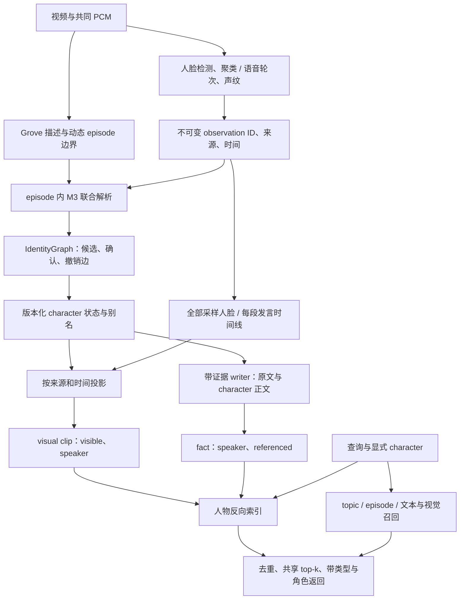

# 人物引用、并行召回与身份修订

现在还支持独立的 fact→evidence→clip 边，语音时间与视觉定位不会从人物共现推断，见 [FACT_CLIP_EVIDENCE.md](FACT_CLIP_EVIDENCE.md)。人物图修订会保留这些原始时间证据并重建 clip 引用。

补齐三项：完整检测时间线到 clip 的人物引用；character → clip/fact 反向索引与并行召回；身份合并/撤销后的正文、引用和索引重建。模型与 M3 聚类/声纹策略沿用原实验，新增部分不调用模型。

## 数据流



当前离线实验按已确定的 episode 裁剪取证；真实 Grove 钩子在 finalize 边界之后、摘要之前。图中两条取证路径表示职责划分，不代表已完成摄像头实时并行调度。

身份源数据保留在 `snapshot.json.graph` / `identity-review` 的 `graph`，包括观测、边和审核日志。Grove 保存轻量 `character_catalog`（观测归属、别名、可选姓名、时间线、覆盖区间）和派生 `character_index`。内容哈希 `identity_state_id` 用于对齐；仅比较整数 revision 不足以区分两个操作数相同的分支。

## 引用与时间

| 节点 | 角色 | 依据 |
|---|---|---|
| clip | `visible` | clip 内实际采样到的人脸时刻，继承该簇代表观测的身份 |
| clip | `speaker` | 与 clip 时间相交的发言，保留交集 |
| fact | `speaker` | writer 引用的发言证据 |
| fact | `referenced` | 正文人物标签及其引用的 memory/utterance |

每条引用保留 `identity_observation_ids`、证据 ID、角色、character 和版本。完整时间线指**全部检测结果**，不意味着检测器不会漏脸，也不把抽样间隙解释为连续可见。M3 噪声、未通过代表脸筛选的簇及短句 speaker 保留为 unknown。

clip 为 `[start,end)`，发言按交集裁剪；时间统一为 Grove 绝对秒。`source_id` 隔离不同录像。跨 episode 的 clip 保留全部同来源重叠父节点，NPZ 的 canonical parent 不变。`face_timeline_complete=false` 表示未覆盖完整窗口或旧版没有完整时间线，不能理解为“没有人物”。

`visible` 与 `speaker` 同时出现不等于做了嘴型同步或主动说话检测；也不自动产生 actor/mentioned 标签。回答上下文显示角色，完整结果保留时间证据。

## 独立 CPU 命令

按 RUNBOOK 先得到新版 `perceive` / `associate` 输出。快照新增 `identity_state`、`temporal_evidence`、`face_timeline_complete`。以下命令不加载模型。

独立投影的 `clips.json` 示例（来源必须与快照一致）：

```json
[{"id":"clip-1","source":"recording-1","start":86400,"end":86405}]
```

```bash
python -m lab project-clips --state runs/assoc/snapshot.json \
  --snapshot runs/assoc/snapshot.json --clips clips.json --out runs/clip-characters.json
```

审核文件 `changes.json` 使用 `graph.links` 中的实际 link ID。合并可在 `links` 新增候选边，再在 `reviews` 确认；撤销只修改已有边。可选 `names` 登记姓名到原始观测，不从外观猜姓名。

```json
{
  "links": [],
  "reviews": [{"link_id":"实际边 ID","status":"revoked","reviewer":"operator","reason":"人工复核错误关联"}],
  "names": {"小王":["实际 face observation ID"]}
}
```

```bash
python -m lab identity-review --snapshot runs/assoc/snapshot.json \
  --changes changes.json --out runs/reviewed-state.json
python -m lab grove-project --graph runs/grove/hypergraph.json \
  --state runs/reviewed-state.json --out runs/grove/hypergraph-reviewed.json
python -m lab character-lookup --graph runs/grove/hypergraph-reviewed.json \
  --character 小王 --role visible --out runs/person-clips.json
```

`grove-project` 可重复传 `--snapshot` 导入各 episode 时间线；新版 writer 图自带输入。所有输出要求新路径，验证后原子发布，保留原图对照/回滚。`character-lookup` 查反向索引，不做问题相关性排序；可重复 `--character`/`--role` 求并集。

## Grove 接入与召回

新版 `grove-write` 自动建立 catalog/index。完整 Grove 的 builder 在保存前、核心检索在检查文本索引前调用 `refresh_character_projections()`。视觉窗口构建后也可调用 `rebuild_characters(graph, state, snapshots)`，成功后替换/保存返回的新图。原生构建 API 的 episode 需赋予正确 `source_id`。

```python
result = await grove.retrieve(
    "他昨天说了什么？",
    characters=["person:实际观测ID"],  # 或登记姓名；不自动解析问题中的姓名
    character_roles=["speaker"], source_id="recording-1",
    current_time_span="DAY1-00:00:00-00:10:00",
)
```

`HierarchicalRetriever.retrieve` 也支持这些参数。week retrieval 的 `hierarchical_v2_day` 增加 `--character`、`--character_role`、`--source_id`；在 VISUAL_RETRIEVAL.md 的命令后追加即可。其他旧 mode 不支持人物通道，传人物参数会报错。

人物召回查允许日期/来源/cutoff 内的全局索引，不受 topic/episode 语义 top-k 限制。与语义命中按 `(node_type,id)` 去重，共享最终预算。语义分数保留现有 rank/传播方式；人物通道提供等权 `1/60` 加分。角色过滤只限制人物通道，语义通道仍可提供其他证据。

结果包含 `matched_characters`、`retrieval_channels`。低视觉 cosine 不挡住身份命中；关闭 visual channel 则只召回人物 facts。混合检索仍需视觉索引/encoder，服务故障不会静默掩盖；只查人物可用不加载 encoder 的 `character-lookup`。

## 合并、撤销与一致性

- 从不可变观测重算映射，保留 feature 文本、writer 原文；直接 `<person:...>` 也绑定原始证据。
- 分裂后一个 feature 若对应多人，正文转 `<unknown>`；单条发言仍按自身观测归属，不任意选一个人物。
- clip、fact/episode 正文、引用与反向索引在新图上全部成功才发布。旧版已知人物引用若没有观测 ID，需重跑 writer。
- topic 摘要还没有证据绑定。身份变化时其显式人物 token 置 unknown，登记 `invalidated_topics` 待重新摘要。
- 查询前验证节点内容及父节点范围指纹。文本缓存按内容检查，节点数不变也会重建；保存失败不写新标记。视觉像素向量无需因人物 ID 改名重算。
- 本版用全量重建验证正确性，不实现多写入者事务。应用审核状态时先停止同一图的写入，重建/保存后恢复。

## 升级、测试与评测

现有服务器先备份旧 `vendor/Grove`，再运行 `python scripts/setup_grove.py`；仅 `git pull` 不会更新被忽略的 vendor 目录。旧快照没有完整时间线，需重跑 `perceive`、`associate`、`grove-write`，不能从三张代表脸补出真实出现时间。

```bash
python -m unittest discover -s tests/modules -t . -v
python -m unittest discover -s tests/grove -t . -v
python scripts/smoke_characters.py runs/characters-smoke-new
```

独立模块验证投影、unknown、合并/撤销、别名/角色和版本；Grove 测试执行真实 writer、节点/图保存重载、边界钩子、跨 episode clips、两条检索入口、范围过滤和缓存失效。smoke 保存前后图、状态、NPZ 和召回结果，明确 synthetic。

GPU 评测继续使用 speech / equivalence / character 三阶段指标。检索另需标注相关 clip/fact，固定图、查询集和 top-k，对比语义召回与增加人物通道后的分类型 Recall@k、Precision@k 和错误人物归属率。当前没有真实识别率/召回率结论；完整 Grove 仍需补齐上游缺失文件，见 preflight/VALIDATION。
