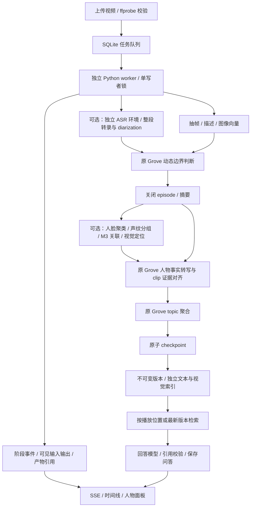

# Grove 时间线工作台

这是接入真实 `lab.full_loop → StreamingMemory → VideoHypergraphBuilder / HierarchicalRetriever` 的内网服务。生产入口不会使用测试模型或虚构输出。浏览器页面无需 Node、CDN 或前端构建，在 FastAPI 中随服务提供。

## 1. 原来没有什么，这次补了什么

| 原来 | 现在 |
|---|---|
| CLI 接收本地路径、结束后导出结果 | 浏览器流式上传 MP4，ffprobe 校验，Range 播放；后台子进程排队处理 |
| 中间文件散落在运行目录 | observer 在真实模型调用和窗口事务边界发事件；SQLite 持久化；SSE 断线续传 |
| 只能看到最终图和当前 checkpoint | 每次图变化保存独立版本，区分输入已观察时间、记忆覆盖时间和索引就绪 |
| CLI 查询返回 typed evidence | 从所选版本检索 fact + visual clip，再由配置模型生成回答并校验引用 ID |
| 人物结果主要靠读 JSON | 查看代表脸、face/voice → character 映射、候选/采纳状态、发言与来源；点击回看 |
| 视觉主导 episode 边界 | 新增可选 `boundary_use_transcript`，把窗口范围内的转录加入原边界模型输入 |

保留原 Grove 动态分段、摘要、facts、topic、检索和人物 provider 架构；没有再建一套平行的记忆图。`lab/observability.py` 不依赖 Web 库，原 CLI 不传 observer 时仍可独立运行。

## 2. 页面与数据流程



- **播放位置**：播放器的位置，可随意拖动；不控制后台推理速度。
- **窗口已处理**：已成功提交的 caption 窗口输入上界，不等于已经形成 episode。
- **记忆已覆盖**：最新可查询版本中已经关闭的 episode 上界。
- **截至播放位置**：只选 `input_frontier <= playback_time` 且索引就绪的版本。例：0–4 秒的 episode 到观察完 4–6 秒才关闭，在 5 秒提问仍不能使用它；到 6 秒才可使用。
- **最新已提交记忆**：查询当前最新就绪版本，可能包含播放器尚未播放的内容。

阶段面板始终显示本任务真实处理日志，历史查询范围只作用于记忆/人物面板与新问题。旧回答保存原 `memory_version`；点击引用回看不会用新版本重写旧回答。字幕、边界理由、JSON、脸图、音频等可从事件产物打开。正文安全渲染为文本，不执行视频文本或模型输出中的 HTML。

ASR 首版仍使用完整音轨，diarization 可能使用后文上下文，页面明确标记“整段离线音频”。转录送入边界模型时限制到当前窗口范围，但这**不是严格无未来音频上下文的流式实验**。目前是实时观察后台推理和历史记忆回看，不按原 wall-clock 耗时重演事件，也不承诺推理快于视频 1 倍速。

## 3. 先运行核心服务

在仓库根目录执行。真实模型下载、vLLM 与 SigLIP 启动按 [离线部署手册](OFFLINE_DEPLOYMENT.md) 第 1–6 节完成；`deploy-visual.local.json` 必须使用实际 endpoint、model、revision。启用 `use_visual_channel=true` 才能联合检索 visual clip 与 fact。

```bash
python3.11 -m venv .venv
source .venv/bin/activate
pip install -r requirements-workbench.txt
python scripts/setup_grove.py

# 已有真实 API 时，生成的配置指向这些服务。
python scripts/configure_offline.py --stage visual --models /models \
  --output configs/deploy-visual.local.json
python scripts/preflight.py --config configs/deploy-visual.local.json

# 首次只启用核心配置；不要引用尚未生成的人物配置文件。
python -c 'import json,pathlib; pathlib.Path("configs/workbench.local.json").write_text(json.dumps({"core":{"config":"configs/deploy-visual.local.json","description":"核心 + 视觉检索"}},ensure_ascii=False,indent=2))'

python -m lab.workbench --profiles configs/workbench.local.json \
  --data runs/workbench --host 0.0.0.0 --port 8080
```

浏览器访问 `http://服务器IP:8080`，选择配置、上传视频。默认地址是 `127.0.0.1`；上述命令显式允许内网访问。此版本是受信内网单用户实验服务，没有账户、租户隔离或公网鉴权；如经反向代理共享，使用组织已有访问控制，并关闭 SSE 代理缓冲、放宽上传大小/超时。

核心流程默认不启用人物或音频语义；若只想给边界判断加入转录，可在服务器 profile 中增加 `speech_config`，同时将核心配置的 `boundary_use_transcript` 设为 `true`。服务会为每个新上传视频先生成独立 ASR 结果，即使未开启人物。

## 4. 再开启人物模块：自动对上传视频做 ASR

人物模型、CUDA 依赖及权重仍按 [离线部署手册](OFFLINE_DEPLOYMENT.md) 第 7–8 节准备。本服务新增 `workbench` Docker target：主环境沿用 M3/人脸/声纹环境，另建 `/opt/asr-env`，避免 pyannote 4 的 Torch 2.8 覆盖 M3 的 Torch 2.6。

在联网 Linux 上额外构建并导出（复用原手册保存的 `SPEAKERLAB_REVISION`）：

```bash
docker build -f deploy/Dockerfile --target workbench \
  --build-arg SPEAKERLAB_REVISION="$SPEAKERLAB_REVISION" \
  -t grove-workbench:offline-v1 .
docker save -o "$GROVE_ASSETS/grove-workbench.tar" grove-workbench:offline-v1
```

在内网 Linux 上导入、生成 profile、启动；vLLM/SigLIP API 继续单独运行：

```bash
docker load -i "$GROVE_ASSETS/grove-workbench.tar"

# 无需拿另一份视频的旧转录占位。每个上传任务都会生成自己的 ASR 文件。
bash deploy/run.sh core python scripts/configure_offline.py \
  --stage characters --for-workbench --accept-model-links \
  --output configs/workbench-characters.local.json
cp configs/workbench.example.json configs/workbench.local.json

# 2 是示例物理 GPU 号；选择留给 ASR + 人物 worker 的卡。
GROVE_GPU=2 bash deploy/run.sh workbench python -m lab.workbench \
  --profiles configs/workbench.local.json --data runs/workbench \
  --speech-python /opt/asr-env/bin/python --host 0.0.0.0 --port 8080
```

`configs/workbench.example.json` 的 ASR profile 使用 `configs/whisper_pyannote.json`：本地 faster-whisper large-v3 + pyannote community-1；模型路径必须与手册 `/models` 相同。中文可复制为 `.local.json` 并设 `language:"zh"`。也可换成已有 Gemini/FunASR 配置进行实验，工作台不绑定 Gemini。

`--for-workbench` 自动打开转录参与边界判断；它只免除“配置生成时必须提供旧视频转录”的要求，不免除模型文件/revision 校验。`--accept-model-links` 表示按实验策略采纳 M3 的 equivalence，**不是人工核验**；不加则保留候选关联。两种设置使用新任务分别跑。

使用原生虚拟环境时，在人物环境安装 `requirements-workbench.txt`，`--speech-python` 指向独立 ASR 环境的 Python。ASR 子进程结束后才开始人物推理，可释放其显存；不要把 pyannote4 直接装进 M3 环境。Docker 配方新增部分未在本机执行 Linux GPU 构建，部署时仍需 `pip check`、CUDA import 与真实样本验收。

## 5. 视频、任务和持久化

- 首版上传接受 **MP4 / H.264 / AAC 或 MP3**，默认最大 4 GiB，可用 `--max-upload-gb` 修改。编码不匹配返回 415，不会收下无法在常见浏览器播放的文件。可先转换：

  ```bash
  ffmpeg -i input.mkv -map 0:v:0 -map '0:a:0?' -c:v libx264 \
    -pix_fmt yuv420p -c:a aac -movflags +faststart output.mp4
  ```

- 上传以字节流写盘，前端显示上传进度；失败/超限清理临时媒体。浏览器不能上传 Python、模型地址或推理配置，仅能选服务器登记的 profile。
- 一个数据目录只启动一个 Web 进程；worker 通过全局 compute 锁串行运行，每个任务还有独立写锁。查询线程只读自己的版本并使用该版本的独立索引。
- “停止”等待当前 ASR/模型调用或窗口完成，不会强行中断 CUDA。失败、停止、进程异常的任务可恢复；上传文件和配置已固定，恢复拒绝不兼容 checkpoint。
- Web 重启不强杀正在推理的 worker；重启后依据进程锁恢复任务状态。worker 异常退出标为 interrupted，用户恢复；已提交 checkpoint 会补发缺失的版本/索引事件。
- `runs/workbench/` 包含 SQLite、上传文件、每个任务的配置、日志、pipeline、trace、versions 和问答记录。备份整个目录；人物证据含绝对路径，恢复时保持相同挂载路径。该目录被 Git 忽略，视频、声纹和问答不会自动推到 GitHub。
- 快照目前保存完整 checkpoint 和对应索引；长视频会增加磁盘和重建成本。没有自动清理策略；应在停止服务、任务均结束后按整次实验备份/清理数据目录。

问答只允许引用本次 Grove 实际检索的 IDs，校验正文 `[C1]` 与返回的 `citation_ids` 一致；时间来自原证据，不由回答模型自由填写。无就绪版本/检索为空会明确回答证据不足；模型报错或格式/引用不合法返回失败，不保存伪造替代答案。此校验能发现不存在的引用，**不能证明每个自然语言结论都被证据语义支持**；忠实度仍需人工评测。

## 6. 接口和源码

| 入口 | 职责 |
|---|---|
| `lab/workbench/app.py` | 上传、媒体 Range、任务、SSE、快照、证据、问答 API |
| `lab/workbench/worker.py` | 真正的 ASR 子进程与 Grove 主循环、运行锁、停止/恢复 |
| `lab/workbench/runtime.py` | observer、快照发布/索引恢复、真实检索和引用回答 |
| `lab/workbench/store.py` | SQLite 任务、递增事件、快照/问答、受控文件 ID |
| `lab/workbench/static/` | 无外部资源依赖的中文时间线页面 |

`GET /api/profiles`、`POST /api/videos?filename=...`（raw body）、`POST /api/runs`（`video_id,profile`）、`GET /api/runs/{id}/events?after=...`（SSE；支持 Last-Event-ID）、`GET /api/runs/{id}/snapshot?playback_time=...` 或 `?version=...`、`POST /api/runs/{id}/questions`（`question,playback_time,characters`）、`GET /api/runs/{id}/questions`、`POST .../stop`、`POST .../resume`。`playback_time:null` 表示最新就绪版本。`GET /docs` 为完整 OpenAPI。

事件 `seq` 在数据目录内递增，`stage/state` 区分开始、原始响应、完成、失败与正式提交；`attempt_id` 关联同一调用。模型可见输入/响应保存在 trace JSON，图像 base64 以摘要表示；不保存请求 Authorization header 或模型内部思考。页面保留最近 300 条事件，完整事件仍在 SQLite/API 中。

## 7. 测试与真实模型验收

```bash
pip install -r requirements-workbench.txt
python -m unittest tests.modules.test_workbench -v
python -m unittest tests.grove.test_workbench -v
python -m unittest discover -s tests -t . -q
python scripts/check_clean_export.py --report runs/workbench-clean-check.json
```

独立测试覆盖上传校验/大小限制/清理、Range、受控 artifact/哈希、防越权、SSE 游标与幂等、引用校验、历史版本选择。接入测试使用实际视频解码、实际 worker 子进程及完整 Grove：边写边问、facts/visual clip 联合召回、过去 topic 不被最终版本覆盖、失败窗口不发布、恢复不重复、人物/发言精确时间和代表脸。

浏览器测试是独立可选工具，生产不依赖 Playwright：

```bash
# 开发机安装在独立工具目录，避免把 node_modules 加进项目。
mkdir -p /tmp/grove-browser-tools
npm install --prefix /tmp/grove-browser-tools playwright
/tmp/grove-browser-tools/node_modules/.bin/playwright install chromium

# 终端 1：明确使用合成模型的工程验收服务
python -m tests.serve_workbench --out runs/browser-check --port 8088
# 终端 2：video/output 使用绝对路径
PLAYWRIGHT_MODULE=/tmp/grove-browser-tools/node_modules/playwright \
  node tests/workbench_browser.cjs http://127.0.0.1:8088 \
  "$PWD/runs/browser-check/browser-test.mp4" "$PWD/runs/browser-check/screenshots"
```

工程测试在模型预测边界使用显式 fixture，Grove 核心、关联算法、证据对齐、检索索引和 Web 流程都实际运行；不能据此声称真实 ASR/人脸/声纹/M3/问答准确率达标。部署后先跑仓库 AMI 短片，再上传仓库提供的《圆桌派》连续 8 分钟中文访谈，核验发言文字与时间、跨镜头 character、错配/unknown、每条 fact 的 clip 证据，以及回答是否真的得到引用支持；最后再跑长片。已下载的 43:59 整期、短片、来源和校验命令见 [演示素材](DEMO_VIDEO.md)。

2026-11-26 本机验收：干净导出重新还原 29 个 Grove 补丁文件，105 个 Python 文件语法检查通过；独立模块 **113** 项、Grove 接入 **75** 项通过（共 **188** 项），另通过 5 个端到端 smoke。Chrome 浏览器通过上传、后台实际 worker、SSE 输出、历史快照、引用回看、刷新恢复和窄屏检查。环境为 macOS / Python 3.13；Linux Docker 构建、GPU 模型性能及中文长视频准确率尚未验证。
