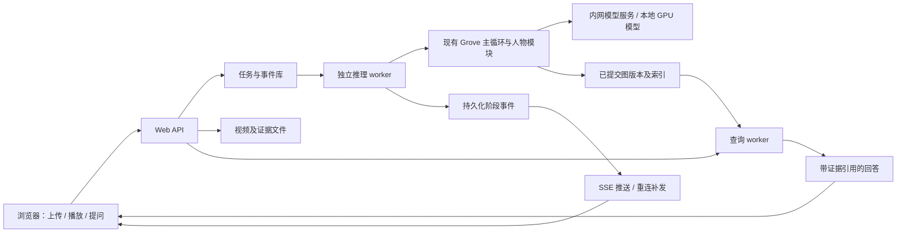

# 视频记忆工作台：交互与服务设计

状态：**设计稿，未实现在线上传、SSE、历史快照服务或回答生成接口**。现有 `lab.full_loop` 仍是离线视频/API 驱动。2026-11-26 已核对代码和中文视频来源，并制作两种可交互界面方案；原型使用虚构样例，不能作为本节目转录、模型预测或评测结果。本页描述拟新增服务与验收要求，不改变现有主循环行为。

## 1. 推荐演示素材

首选《圆桌派》第二季第 11 期 **“AI：圆桌新嘉宾，空前不绝后”**。看理想发布的优酷播单标注 **45:53**；嘉宾为杨强、梁文道、许子东，主持人为窦文涛。官方整期和节目说明已找到，**尚未下载可上传的 MP4，也未观看整期或人工标注**。

- [优酷原视频](https://v.youku.com/v_show/id_XMjg1MzcyNzc3Ng==.html?f=49924360&o=1)
- [看理想优酷播单：可核对标题和时长](https://list.youku.com/albumlist/show/id_49924360.html)
- [优酷官方频道整期入口](https://www.youtube.com/watch?v=UaqMBHZUZuU)
- [优酷纪实人文的本期介绍：可核对参与者](https://www.youtube.com/watch?v=vlEbfmQXC7I)

选择依据是节目类型和参与者结构：中文、四位人物反复出现、有连续议题，适合测跨镜头身份、发言归属、跨 episode 的观点检索以及“之前谁说过什么”。这是素材适配判断，不是对该集实际模型效果的结论。原视频可观看不等于有可直接下载的 MP4；导入实验时记录实际文件来源、SHA256、时长和剪辑范围，不把平台观看链接当成本地视频。平台缓存格式若不能供 ffmpeg 解码，需要可导出的媒体文件。

它的局限也很明确：圆桌访谈的场景变化可能较少，不能仅凭它验证丰富动作/场景检索。先做这条人物/对话主案例，后续另加一段有物品操作、走动或场景转换的视频，验证 visual clip 的独立价值。

建议先选连续 5–8 分钟做联调，再跑完整 45:53。实际截取范围需看片后选择，至少包含多人轮换与话题转折。预备提问包括“谁提出了某个观点”“同一个人后来是否补充了条件”“两位人物的意见有什么差异”“这条事实是原话、视觉观察还是模型概括”；问题中的具体观点和正确时间应在人工复核后填写。

## 2. 推荐展示形式

主界面采用“时间线工作台”，备选采用“问答优先”。二者复用同一个任务、事件与证据模型，不另建两套后端。

| 区域 | 时间线工作台（推荐首版） | 问答优先（后续观看模式） |
|---|---|---|
| 主区域 | 视频、字幕、播放/处理/记忆进度 | 问答及其引用证据 |
| 侧栏 | 当前阶段、人物关联、记忆详情切换 | 小播放器、当前问题的证据详情 |
| 下方 | episode、发言、人物出现、fact 写入的时间轨道 | 紧凑 episode 导航 |
| 主要交互 | 选一段 → 查看如何处理 → 回看原始依据 | 提问 → 展开依据 → 跳回视频 |

人物图作为可展开的检查视图：代表脸 → face 节点、发言片段 → voice 节点、候选/采纳关系 → character → 相关 facts/clips。默认显示当前人物及相邻证据，避免长视频产生的大图挤满首页。候选、模型采纳、人工确认、撤销、unknown 各有明确标签；姓名由明确登记或带来源的名字候选提供，不根据人脸直接猜公众人物姓名。

每个阶段默认展示人能理解的结构化结果，展开后才看输入引用、模型原始可见响应、参数/模型版本、耗时、重试及错误。记录模型返回的边界理由或证据说明，不展示或假造模型内部思维过程。

## 3. 播放、推理、记忆是不同的进度

首版不承诺 GPU 推理始终快于视频 1 倍速，至少分别展示：

- `playback_time`：用户当前播放位置；可以任意拖动。
- `observed_until`：当前运行已经处理到的媒体时间。ASR、caption、人物分别有进度，不能用 ASR 完成冒充所有观察完成。
- `memory_frontier`：一个已提交且可查询版本的记忆覆盖范围；图已提交但索引尚未就绪时另外显示“索引处理中”。

未关闭的 episode 可以展示 captions、转录和“待分段/待关联”，不能显示成已生成的事实。一个 fact 的 `source_time` 和写入它的 `commit_time` 也不同：例如证据在 01:00，模型观察到 01:50 才确定前一个 episode 结束。回到 01:10 时，不能因为事实证据时间早就宣称当时已经形成了这条记忆。

建议首版支持两种任务展示方式：

1. **实时处理观察**：真实 worker 在后台尽快执行，浏览器收到阶段事件即更新。视频可自行播放；进度落后时显示具体等待阶段。这里“实时”指结果实时推送，不承诺实时因果推理或固定延迟。
2. **已完成实验回放**：用一次真实运行保存的事件、快照和耗时，随播放器回放证据演变。明确标记“回放”，不把预计算伪装成现场推理。正式演示可先用此模式，联调时用上一模式。

如果要“模型只看到播放器已播内容”的严格在线模式，还需限制输入供给，并把当前整段 ASR/diarization 改成增量处理。完整音轨上的离线 diarization 会使用后文上下文；仅把显示时间截断并不能证明没有未来信息。这个模式单独实现和评估，不与首版观察界面混称已经支持。

## 4. 当前代码必须补的能力

| 能力 | 当前代码实际状态 | 服务化改动 |
|---|---|---|
| 上传与播放 | CLI 接受服务器本地文件 | 浏览器上传到独立任务目录；ffprobe 校验；可 seek 的媒体服务；上传/准备进度 |
| 中间输出 | captions、人物快照、checkpoint 等已落盘，但没有稳定阶段事件 | 在真正的阶段边界发结构化事件；不要靠正则解析普通日志 |
| 边处理边查询 | `StreamingMemory.retrieve()` 可构建索引并检索；CLI 只在 finish 后执行 `--query` | 查询 worker 使用不可变已提交快照和对应索引，不并发读写同一个可变 builder |
| 回答生成 | 当前 `--query` 返回 typed evidence | 新增基于检索证据的回答 API，输出可验证引用并支持证据不足时回答未知 |
| 历史状态 | 当前权威文件 `checkpoint.json` 持续更新；不是任意时刻的版本库 | 每次提交生成可恢复版本引用，保存当时 topics、人物映射和索引；不能仅过滤最终图的 fact 时间 |
| 访谈话题分段 | `episode_segmenter._detect_boundary_stream` 当前基于 frames，且不使用 chunk overview 判断语义边界 | 增加可选 transcript-aware boundary 输入，只提供当前观察窗口已到达的转录；保持人物关联在 episode 边界之后 |
| ASR 启动 | `identity_provider_factory` 在 caption 循环前准备整段语音 | 首版显示准备阶段，可复用此前 ASR；需要增量时另做队列/切片/跨窗 speaker 连续性 |

不能给 `lab.full_loop` 套上传按钮就声称所有能力齐全。主循环中应增加可选 observer/callback；原有 CLI 不传 observer 时保持行为。人物分支在 `stream_identity.py` 的 perception、associate、grounding 边界发事件；Grove 内在 boundary、summary、fact/topic、commit、index 边界发事件。

增加转录输入时，先用匿名的局部 speaker ID 和真实发言时间，不要求知道 character。现有“语音预处理 → episode 边界 → 脸声关联 → character 写入”的依赖顺序仍成立。若要让核心关闭人物时也能理解访谈语义，应把 speech 前端提升为独立可选阶段，让分段与人物共同消费同一个转录产物。

## 5. 服务架构与接口草案

建议第一版在内网运行：React/TypeScript 页面 + FastAPI 控制服务 + 独立 Python 推理进程 + SQLite 任务/事件库 + 现有文件产物。先按 GPU 资源串行排队，不先引入多机任务集群。页面不直接持有模型密钥。



API 草案（尚未提供对应可执行入口）：

| 接口 | 作用 |
|---|---|
| `POST /api/videos` | 分块写盘上传，返回视频 ID、哈希和元数据；限制大小，不把完整长视频读入 RAM |
| `POST /api/runs` | 按服务端模型配置创建任务；模型预检、排队、启动 |
| `GET /api/runs/{id}` | 任务状态、分阶段进度、当前提交/可查询版本 |
| `GET /api/runs/{id}/events` | SSE，携带递增 event ID；断线后从 last-event-id/cursor 继续补发 |
| `GET /api/videos/{id}/media` | 支持浏览器 Range 请求和拖动定位 |
| `GET /api/runs/{id}/snapshots/{version}` | 查看该版本的 episode/fact/topic/人物索引及来源，不返回将来的状态 |
| `GET /api/runs/{id}/artifacts/{artifact_id}` | 帧、脸裁图、音频切片、模型可见输入输出等；服务端解析白名单产物 ID |
| `POST /api/runs/{id}/questions` | 固定问题、检索范围、版本及 playback time，返回回答/引用 |
| `POST /api/runs/{id}/stop` | 请求安全停止，标明正在结束当前阶段；恢复使用已提交 checkpoint |

上传采用 FastAPI 的 `UploadFile` 方式，但重型模型推理放独立进程，避免占住 Web 请求；阶段通知优先选服务端单向推送的 SSE，控制动作用普通 HTTP。实现可依据 [FastAPI 上传文档](https://fastapi.tiangolo.com/tutorial/request-files/)、[后台任务的重计算注意点](https://fastapi.tiangolo.com/tutorial/background-tasks/#caveat)、[SSE 事件与重连机制](https://developer.mozilla.org/en-US/docs/Web/API/Server-sent_events/Using_server-sent_events)。

## 6. 事件、版本与防止“偷看未来”

所有事件至少包含：

```json
{
  "schema_version": 1,
  "run_id": "example-run",
  "seq": 123,
  "stage": "facts",
  "state": "completed",
  "source_id": "example-video",
  "media_start": 60.0,
  "media_end": 96.0,
  "input_frontier": 108.0,
  "episode_id": "example-episode",
  "attempt_id": "example-attempt",
  "transaction_id": "example-window",
  "graph_version": null,
  "artifact_ids": ["example-facts-output"],
  "wall_time_utc": "2026-11-26T00:00:00Z"
}
```

这是协议示例，不是本次运行日志。`completed` 表示该模型/算法阶段成功，不表示整个窗口已提交。只有 checkpoint 发布成功后才能发 `memory_committed`，只有对应索引可用后才能发 `index_ready`。失败尝试保留审计，UI 标记回滚；不能把它们计入正式 facts/人物。

文件 checkpoint 与 SQLite 事件不能假定天然跨存储原子提交。以 checkpoint 中的版本/事务 ID 为权威：先确保提交产物可恢复，再发布幂等事件；进程重启时补发遗漏事件，按唯一键去重。前端 SSE 重连也按 seq 去重。

提问默认使用“截至播放位置的可用记忆”。查询服务选择满足以下条件的不可变版本：实际已提交、所需索引就绪、当前任务可访问、版本使用的观察范围不晚于用户播放位置。界面显示其覆盖时间；没有可用版本就返回等待或证据不足。用户可显式切换“截至后台处理位置”，但不能悄悄扩展范围。

**只过滤 fact/clip 的时间不够。** 最终 topic 摘要可能综合后续内容，后续人脸/声音合并也可能改变早期人物归属，早期 episode 的边界判断可能观察了下一个窗口。历史提问必须使用当时版本的 graph、topic、身份映射和索引，并记录 `input_frontier`/可用点。首版如果用完整音频离线 ASR，必须标记“离线观察回放”，不能把这个版本机制宣传为严格无未来音频上下文的在线实验。

已经生成的回答固定保留 `question_id`、`graph_version`、提问时 playback time、检索范围、证据列表。点击旧回答引用回到 01:00，仅改变播放器；该引用面板仍标注“查看回答时版本 vN 的证据”。新的问题按新的播放位置选择版本，旧回答不会被悄悄改写。这样既能回看证据，也不会把后来的记忆伪装成早期已知内容。

## 7. 问答与人物展示

问答链为“问题 → 固定版本 → Grove 检索 → typed facts/clips/person references → 回答模型 → 引用校验”。生成回答可复用现有 writer 服务，无需第一版再部署一种 LLM，但要新增专门的回答提示词和输出协议。

回答至少返回 `answer`、`citations`、`memory_version`、`coverage`、`insufficient_evidence`。引用必须落在检索输入集合中；每条引用可展开 fact 原文、发言/帧、character 映射来源和具体时间。模型概括与直接转录分别标记，不能把推断写成原话；没有定位到视频时明确显示未定位，不虚构跳转时间。

首版人物面板支持查看身份、代表脸、声音回放、出现/发言时间线及相关 facts。人工确认/撤销应另设审核分支：当前 `identity-review → grove-project` 还不能自动导回主循环 checkpoint，因此第一版不放一个看似即时生效的“合并人物”按钮。审核写回待有正式版本迁移后再开放。

## 8. 首版范围和验收

首版应一次覆盖：本地视频上传/播放、单任务 worker、可恢复事件流、阶段产物展开、动态 episode 时间线、人物观察/映射面板、版本化记忆与检索、带引用的回答、证据跳转、真实运行结果回放。摄像头接入、多源并发、在线人工合并以及严格增量 ASR 不在这一版内。

| 测试层 | 必须验证的行为 |
|---|---|
| 独立事件/版本模块 | 阶段完成与事务提交区分；重复事件幂等；崩溃补发；未来 topic/人物合并不进入历史版本 |
| Grove 接入 | observer 不改变原 CLI 的图结果；动态边界之后才关联身份；旧配置回归；事实/索引失败不会广播已提交成功 |
| Web/API | 大文件流式写盘与上传失败；Range/seek；SSE 断线补发；停止恢复；并发提问不读到半成品 |
| 问答 | 证据不足与未处理范围；引用必须属于检索结果；字幕里的人名不自动成为身份；切换播放位置保持旧回答版本固定 |
| 浏览器流程 | 上传 → 处理进度 → 点 episode → 展开 face/voice → 提问 → 点击引用跳回视频；刷新不丢任务 |
| 真实模型 | 同一视频/时间范围跑关闭人物与启用人物；对人工标注的身份、原话、证据时间与问答计分；记录处理速度与显存 |

访谈分段单独对照：保留当前纯视觉分段基线，新增“同样帧描述 + 当前转录”的配置；固定视频、模型版本、采样、buffer 上限，人工标注话题/活动边界，比较边界容差下的 precision/recall 与 episode 内容完整性。不要把模型更换、ASR 更换和分段输入变化混在一次对比里。人物模块仍在边界确定后运行，再观察不同边界对脸声关联和 character 归属的影响。

展示样例不等于准确率集：联调片段与最后验收片段分开；问题/答案/人物标签/证据时间独立标注，不用本系统自己的生成结果当真值。
